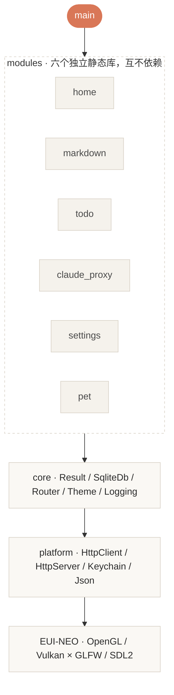

<div align="center">

<br>


<br>
<br>

# DevDesk

**把日常散落的开发琐事，收进同一个窗口**

原生 C++20 GUI · 单文件可执行 · 零外部运行时依赖

[](#平台支持)
[](#架构)
[](#架构)
[](#快速开始)
[](#项目状态)

<br>

[功能](#功能) · [截图](#截图) · [快速开始](#快速开始) · [架构](#架构) · [项目状态](#项目状态) · [文档](#文档)

</div>

---

<h2 align="center"><a name="功能"></a>✨ 功能</h2>

<table align="center">
<tr><th align="left" width="200">模块</th><th align="left">做什么</th></tr>
<tr>
<td><b>Markdown 笔记本</b></td>
<td>笔记就是普通 <code>.md</code> 文件，不锁定格式 —— 随时可以拿别的编辑器打开，或者直接丢进 Git。<br>
FTS5 全文搜索（中文可用）、目录树、标签、大纲面板；编辑 / 双栏 / 预览三态，400ms 自动保存。</td>
</tr>
<tr>
<td><b>Todo 看板</b></td>
<td>多列看板，拖拽跨列 + 同列重排（可插到两张卡之间）。<br>
优先级直接体现在卡片底色上；截止日期、标签、搜索、逾期视图。</td>
</tr>
<tr>
<td><b>Claude 配置切换器</b></td>
<td>多套 API Profile 管理 + 本地流式代理（SSE 逐块透传）。<br>
启动代理即自动接管 Claude Code <code>settings.json</code>，停止时按键还原；多 Profile 失败自动 failover。</td>
</tr>
<tr>
<td><b>首页仪表盘</b></td>
<td>今日笔记 / 待办 / 逾期 / API 调用统计；Token 速率取自最近一次成功调用，用量按小时分布。</td>
</tr>
<tr>
<td><b>设置</b></td>
<td>外观（主题 / 全局字号 / 窗口效果三档）、模块插拔、桌宠、笔记目录、代理端口与接管状态、日志保留。</td>
</tr>
<tr>
<td><b>桌宠</b></td>
<td>无边框置顶透明小窗，可拖拽、四态动画、气泡对话、右键菜单；默认关闭，需要时再开。</td>
</tr>
</table>

---

<h2 align="center"><a name="截图"></a>📸 截图</h2>

<table align="center">
<tr>
<td width="48%">

<p align="center"><sub><b>Todo 看板</b><br>优先级即卡片底色，拖拽跨列 / 同列重排</sub></p>
</td>
<td width="48%">

<p align="center"><sub><b>Markdown 笔记本</b><br>目录树、标签与三态视图</sub></p>
</td>
</tr>
<tr>
<td width="48%">

<p align="center"><sub><b>Claude 切换器</b><br>Profile / 模型映射 / 环境变量 / 调用记录</sub></p>
</td>
<td width="48%">

<p align="center"><sub><b>关于</b><br>版本、依赖与构建信息一目了然</sub></p>
</td>
</tr>
</table>

---

<h2 align="center"><a name="快速开始"></a>🚀 快速开始</h2>

> [!IMPORTANT]
> DevDesk 依赖 **[EUI-NEO](https://github.com/sudoevolve/EUI-NEO)**，源码需要放在 DevDesk 的**同级目录**（不是 submodule）：

```text
your-workspace/
├── DevDesk/     ← 本仓库
└── EUI-NEO/     ← GUI 框架
```

### 装依赖

<table align="center">
<tr><th align="left" width="150">平台</th><th align="left">命令</th></tr>
<tr><td><b>macOS</b></td><td><code>brew install cmake ninja openssl@3</code></td></tr>
<tr><td><b>Windows 11</b><br><sub>MSYS2 MinGW64</sub></td><td><code>pacman -S mingw-w64-x86_64-gcc mingw-w64-x86_64-sqlite3 mingw-w64-x86_64-curl mingw-w64-x86_64-openssl</code></td></tr>
</table>

### 构建 + 测试 + 运行

一条命令，别手敲 cmake：

```bash
bash scripts/build-test-run.sh --release
```

它会按顺序做完：**杀旧进程 → 增量构建 → 跑测试 → 启动 app**。工具链 PATH、OpenSSL 路径、
ccache、EUI-NEO 定位、模块隔离守卫全部封装在里面 —— 手敲 `cmake -B …` 会漏掉这些约定，
造出互相漂移的构建目录（详见 [`CLAUDE.md`](CLAUDE.md)「常用命令」段）。

<details>
<summary><b>脚本开关</b></summary>

<br>

| 开关 | 作用 |
|---|---|
| `--clean` | 全量重建（默认增量） |
| `--release` | Release 构建（构建目录切到 `build-release/`，与 Debug 互不覆盖） |
| `--no-test` | 跳过测试（测试挂时不阻断启动） |
| `--no-run` | 只构建 + 测试，不启动 app |
| `--install` | **仅 macOS**：构建后重组 `.app` 并覆盖安装到 `/Applications`，装完校验 sha256（防装成旧二进制） |
| `--filter X` | 只跑描述含 X 的用例 |

</details>

<details>
<summary><b>不用脚本时（手敲 cmake）</b></summary>

<br>

仅在你确实需要非标准构建时才用；日常开发请走上面的脚本。

```bash
# macOS
cmake -B build -G Ninja -DCMAKE_BUILD_TYPE=Release \
  -DOPENSSL_ROOT_DIR=/opt/homebrew/opt/openssl@3
cmake --build build && ./build/DevDesk
```

Windows 构建默认静态链接（sqlite3 / curl / ssl / crypto / C++ 运行时），产物是**单个 exe、零外部 DLL**。

</details>

---

<h2 align="center"><a name="架构"></a>🏗 架构</h2>



<h4 align="center">贯穿全局的几条约定</h4>

<table align="center">
<tr><th align="left" width="200">约定</th><th align="left">说明</th></tr>
<tr><td><b>不抛异常</b></td><td>所有错误经 <code>Result&lt;T&gt;</code> 返回，调用方必须显式处理</td></tr>
<tr><td><b>模块隔离</b></td><td>每个 <code>module_*</code> 是独立静态库，之间不可互相依赖</td></tr>
<tr><td><b>core 不反向依赖</b></td><td><code>core</code> 不依赖 <code>platform</code>，也不调用 GUI 框架的运行时行为</td></tr>
<tr><td><b>平台适配接口隔离</b></td><td>平台差异按 <code>*_macos.cpp</code> / <code>*_win.cpp</code> / <code>*_posix.cpp</code> 拆文件、CMake 选源；业务代码里没有平台宏</td></tr>
<tr><td><b>数据根在用户主目录</b></td><td>macOS <code>~/DevDesk</code>、Windows <code>%USERPROFILE%\DevDesk</code>；可用 <code>DEVDESK_DATA_ROOT</code> 覆盖</td></tr>
</table>

---

<h2 align="center"><a name="项目状态"></a>📌 项目状态</h2>

<p align="center">
六个模块全功能运行，可经设置页自由插拔<br>
全量测试 <b>847</b> 条，<b>836</b> 通过 —— 其余 3 条是<b>已知的平台不对称红</b><br>
<sub>（macOS 侧 FileWatcher 为轮询兜底 ×2、keychain 空账号语义 ×1），非回归</sub>
</p>

<h4 align="center">平台支持</h4>

<table align="center">
<tr><th align="left">平台</th><th align="left">状态</th><th align="left">说明</th></tr>
<tr><td><b>macOS 27+</b> (arm64)</td><td>✅ 原生支持</td><td>窗口效果三档（关闭 / 半透 / 磨砂）走原生材质</td></tr>
<tr><td><b>Windows 11</b></td><td>✅ 原生支持</td><td>单 exe 零外部 DLL；窗口效果走 DWM 原生 API</td></tr>
</table>

---

<h2 align="center"><a name="文档"></a>📚 文档</h2>

<table align="center">
<tr><th align="left">文件</th><th align="left">内容</th></tr>
<tr><td><a href="CLAUDE.md"><code>CLAUDE.md</code></a></td><td>开发指南：工具链、构建约定、架构约束、协作纪律</td></tr>
<tr><td><a href="docs/superpowers/specs/"><code>docs/superpowers/specs/</code></a></td><td>设计与需求 spec（权威文档）</td></tr>
<tr><td><a href="docs/USER_GUIDE.md"><code>docs/USER_GUIDE.md</code></a></td><td>使用说明</td></tr>
</table>

---

<div align="center">
<sub>私有项目，保留所有权利。</sub>
</div>
