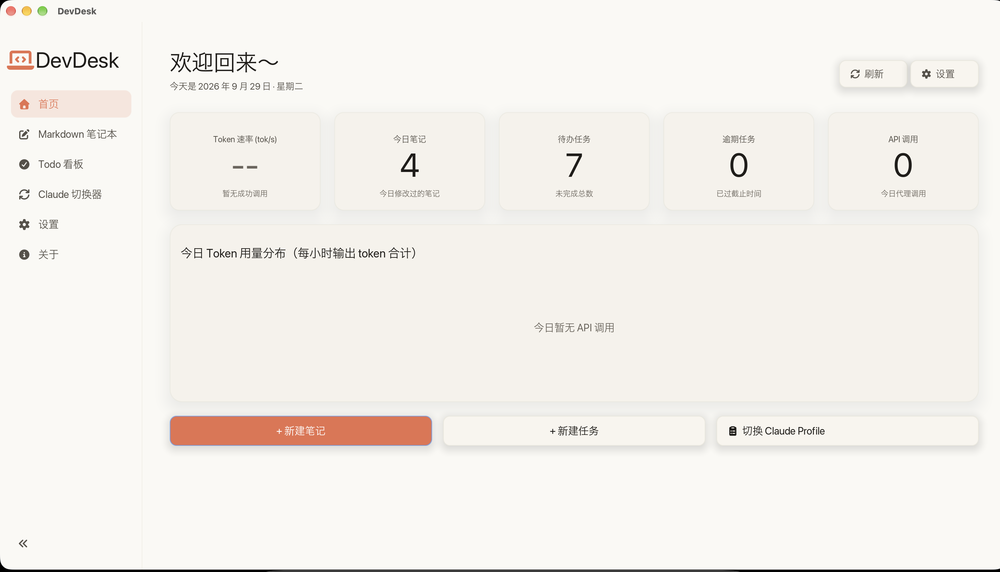
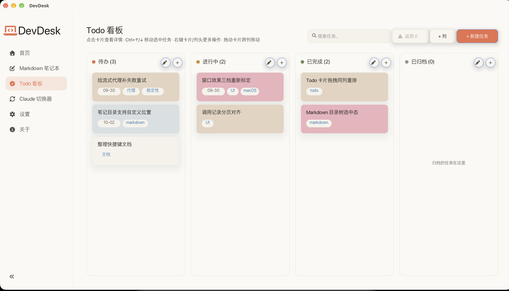
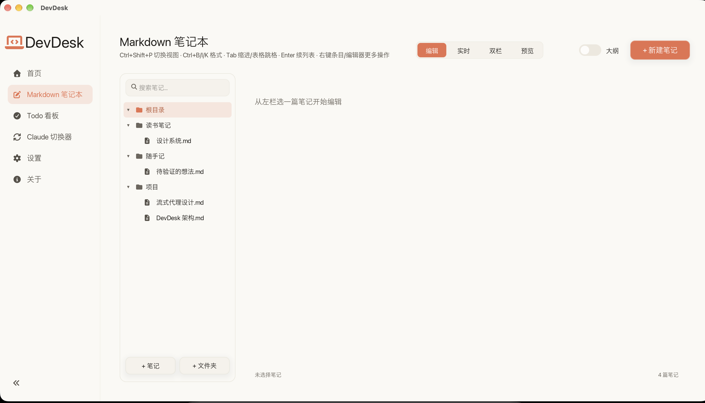
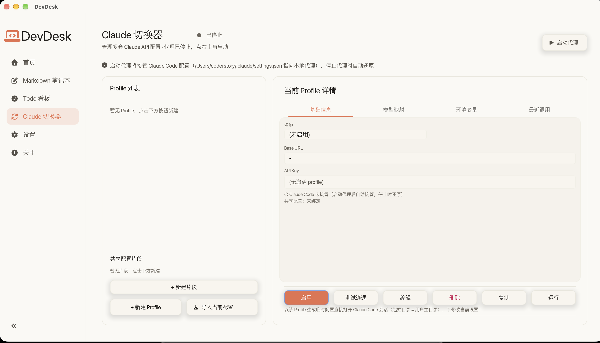
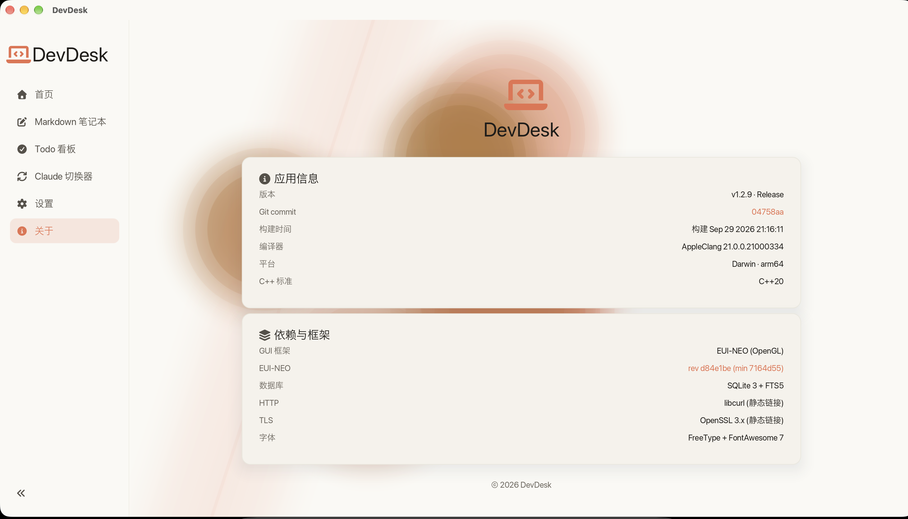

<div align="center">

# DevDesk

**面向开发者的跨平台桌面工具集**

原生 C++20 GUI · 单文件可执行 · 零外部运行时依赖




</div>

---

## 这是什么

一个常驻桌面的开发者工具集，把日常散落在各处的几件事收进同一个窗口：

| 模块 | 做什么 |
|---|---|
| 📝 **Markdown 笔记本** | 笔记就是普通 `.md` 文件，不锁定格式；FTS5 全文搜索（中文可用）、目录树、标签、大纲；编辑 / 双栏 / 预览三态，400ms 自动保存 |
| ✅ **Todo 看板** | 多列看板，拖拽跨列与同列重排；优先级直接体现在卡片底色上；截止日期、标签、搜索、逾期视图 |
| 🔀 **Claude 配置切换器** | 多套 API Profile 管理 + 本地流式代理（SSE 逐块透传）；启动代理即自动接管 Claude Code `settings.json`，停止时还原 |
| 📊 **首页仪表盘** | 今日笔记 / 待办 / 逾期 / API 调用统计，Token 速率与每小时的用量分布 |
| ⚙️ **设置** | 外观（主题 / 字号 / 窗口效果三档）、模块插拔、桌宠、笔记目录、代理端口与接管状态、日志保留 |
| 🐾 **桌宠** | 无边框置顶透明小窗，可拖拽、四态动画、气泡对话、右键菜单；默认关闭 |

<br>

<table>
<tr>
<td width="50%"><br><div align="center"><sub><b>Todo 看板</b> —— 优先级即卡片底色</sub></div></td>
<td width="50%"><br><div align="center"><sub><b>Markdown 笔记本</b> —— 目录树与三态视图</sub></div></td>
</tr>
<tr>
<td width="50%"><br><div align="center"><sub><b>Claude 切换器</b> —— Profile / 模型映射 / 环境变量 / 调用记录</sub></div></td>
<td width="50%"><br><div align="center"><sub><b>关于</b> —— 版本、依赖与构建信息</sub></div></td>
</tr>
</table>

---

## 快速开始

### 前置

- **C++20 编译器**：macOS 用 AppleClang（Xcode Command Line Tools 自带）；Windows 用 MSYS2 MinGW64
- **CMake ≥ 3.14** 与 **Ninja**
- **SQLite3（需带 FTS5）**、**libcurl**、**OpenSSL 3**
- **[EUI-NEO](https://github.com/sudoevolve/EUI-NEO) 源码放在 DevDesk 的*同级*目录**（`../EUI-NEO`）：

```text
your-workspace/
├── DevDesk/     ← 本仓库
└── EUI-NEO/     ← GUI 框架（同级目录，不是 submodule）
```

若放在别处，configure 时用 `-DEUI_NEO_DIR=<路径>` 指定。

### macOS

```bash
brew install cmake ninja openssl@3

cmake -B build -G Ninja -DCMAKE_BUILD_TYPE=Release \
  -DOPENSSL_ROOT_DIR=/opt/homebrew/opt/openssl@3
cmake --build build
./build/DevDesk
```

### Windows 11（MSYS2 MinGW64）

```bash
pacman -S mingw-w64-x86_64-gcc mingw-w64-x86_64-sqlite3 \
          mingw-w64-x86_64-curl mingw-w64-x86_64-openssl

cmake -B build -G Ninja -DCMAKE_BUILD_TYPE=Release
cmake --build build
./build/DevDesk.exe
```

Windows 构建默认静态链接（sqlite3 / curl / ssl / crypto / C++ 运行时），产物是**单个 exe、零外部 DLL**。

> 仓库里有 `scripts/build-test-run.sh` 把「构建 + 测试 + 启动」串成一条命令，并封装了 ccache、平台 PATH、模块隔离守卫等约定。日常开发建议直接用它，别手敲 cmake。

---

## 架构

```text
main → modules (home / markdown / todo / claude_proxy / settings / pet)
            ↓
          core  (Result / SqliteDb / Router / Theme / Logging)
            ↓
        platform (HttpClient / HttpServer / Keychain / Json)
            ↓
         EUI-NEO (GUI 框架：OpenGL / Vulkan × GLFW / SDL2)
```

几条贯穿全局的约定：

- **不抛异常** —— 所有错误经 `Result<T>` 返回
- **模块隔离** —— 每个 `module_*` 是独立静态库，之间不可互相依赖；`core` 不依赖 `platform`，也不调用 GUI 框架的运行时行为
- **平台适配接口隔离** —— 平台差异按 `*_macos.cpp` / `*_win.cpp` / `*_posix.cpp` 拆文件、CMake 选源，业务代码里没有 `#ifdef` 平台宏
- **数据根在用户主目录** —— macOS `~/DevDesk`，Windows `%USERPROFILE%\DevDesk`；可用 `DEVDESK_DATA_ROOT` 覆盖

---

## 项目状态

- 六个模块全功能运行，可经设置页插拔
- 全量测试：`Total 847 / Passed 836`，另 3 条为**平台不对称的已知红**（macOS 侧 FileWatcher 为轮询兜底 ×2、keychain 空账号语义 ×1）
- 主要开发平台是 **macOS 27 / arm64**；Windows 11 为移植目标，两平台都做过完整构建与真机验收

## 文档

| 文件 | 内容 |
|---|---|
| [`CLAUDE.md`](CLAUDE.md) | 开发指南：工具链、构建约定、架构约束、协作纪律 |
| [`docs/superpowers/specs/`](docs/superpowers/specs/) | 设计与需求 spec（权威文档） |
| [`docs/KNOWN_LIMITATIONS.md`](docs/KNOWN_LIMITATIONS.md) | 已知限制 |
| [`docs/USER_GUIDE.md`](docs/USER_GUIDE.md) | 使用说明 |

## 许可证

未声明。本仓库为私有项目，保留所有权利。
